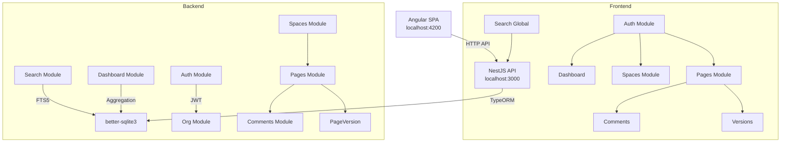

# Architecture — Hermes Team Wiki

## System Diagram

## Data Flow

1. User registers organization → creates org + admin user + default "General" space
2. User creates spaces → each space auto-generates a home page
3. User creates pages with Markdown content → each save creates a new PageVersion
4. Users can comment on pages → comments are scoped by organization
5. Full-text search uses SQLite FTS5 virtual table with auto-sync triggers
6. Dashboard aggregates KPIs via raw SQL queries

## Design Decisions

- **Monorepo with two independent apps** — Simpler than Nx workspace for daily builds
- **TypeORM with better-sqlite3** — Zero-config dev setup, PostgreSQL-compatible schema
- **FTS5 over LIKE search** — Native full-text indexing with relevance ranking and snippets
- **Multi-tenant via organizationId** — Every query filters by org; JWT contains orgId

## Key Principles

- **Multi-tenant isolation** — Every query must include `organizationId` from JWT
- **Signals everywhere** — No Zone.js, no @Input/@Output decorators
- **Standalone components** — No NgModules in Angular
- **Thin controllers** — Business logic lives in services
