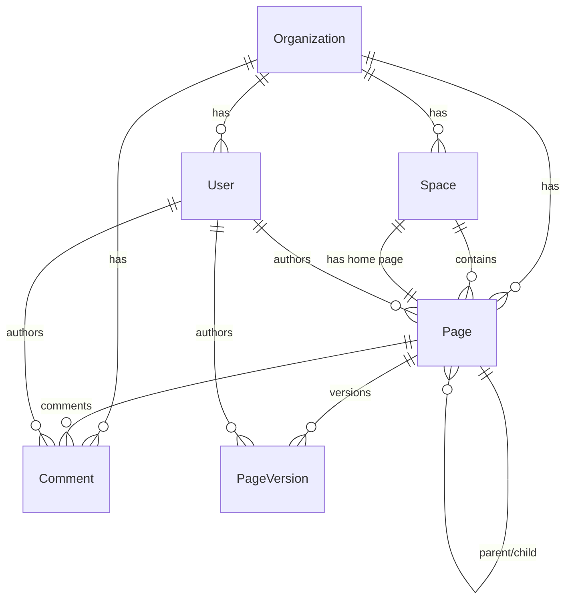

# Database — Hermes Team Wiki

## Entities (6)

## Schema Summary

| Entity | Key Fields | Relations |
|--------|-----------|-----------|
| Organization | id (uuid), name (unique), slug | users, spaces, pages, comments |
| User | id (uuid), email (unique), passwordHash, role(admin/editor/viewer) | organization |
| Space | id (uuid), name, icon (emoji), sortOrder, homePageId | organization, pages |
| Page | id (uuid), title, slug, content (markdown), versionNumber, isHomePage, parentId | org, space, author, parent, children, versions, comments |
| PageVersion | id (uuid), versionNumber, title, content (snapshot), summary, changeStats | page, author |
| Comment | id (uuid), content, isEdited | org, page, author |

## Indexes

- `pages`: [organizationId, spaceId], [organizationId, slug], [organizationId, parentId], [organizationId, updatedAt]
- `page_versions`: [pageId, versionNumber]
- `comments`: [pageId, createdAt], [authorId]
- `spaces`: [organizationId, sortOrder]
- `users`: [organizationId, role], [email]

## Migration Strategy

- Dev: `synchronize: true` via TypeORM (auto-creates tables)
- Prod: Generate SQL migration files in `migrations/` folder
- FTS5: Virtual table created programmatically by `Fts5Service.onModuleInit()`

## FTS5 Full-Text Search

A virtual table `pages_fts` is created on startup with triggers to stay in sync with the `pages` table. Search queries return relevance-ranked results with highlighted snippets.
